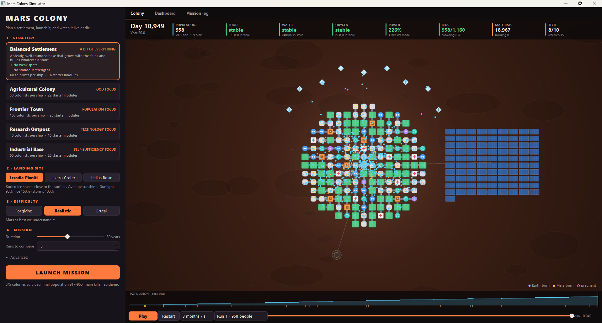
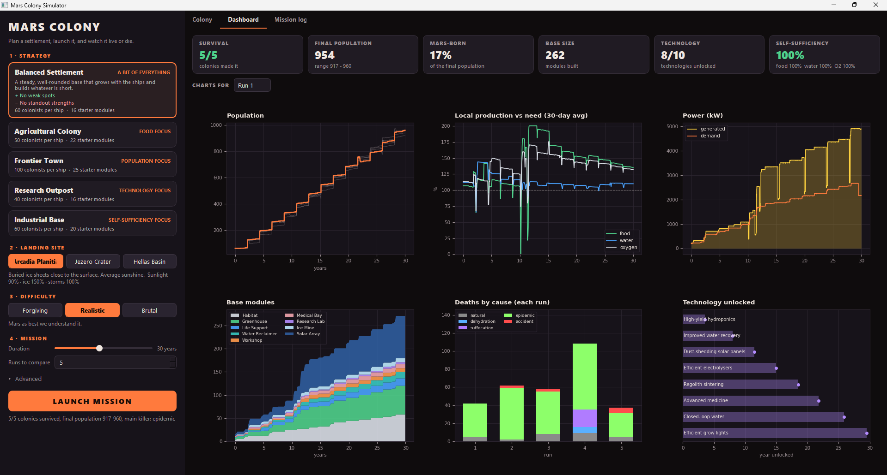

# Mars Colony Simulator

A simulation of a Martian settlement. Pick a strategy, a landing site and a difficulty,
launch, and watch one connected base grow: ships land colonists and prefab modules, people
work, raise families and die, and the base builds whatever it is shortest of - until it
thrives or runs out of air.



## Getting started

You need Python 3.9 or newer.

1. Open a terminal in this folder (on Windows, PowerShell or the VS Code terminal):

   ```
   cd mars_simulation
   ```

2. Install the two libraries it uses, PyQt5 and matplotlib (one-off):

   ```
   python -m pip install -r requirements.txt
   ```

3. Start it:

   ```
   python mars_gui.py
   ```

**If it doesn't start:**

- *`python` is not recognised* (Windows): use `py` instead of `python` in both commands.
- *`No module named PyQt5`*: step 2 installed into a different Python. Use the same command
  (`python` or `py`) for steps 2 and 3.
- *`No such file` for `mars_gui.py`*: you're not in this folder. The path has spaces, so put it
  in quotes when you `cd`.

## How to play

You don't steer the colony directly: you make the big decisions before launch, then watch
how they play out.

1. **Pick a strategy** in the left panel. Click a card to see its strengths and weaknesses.
2. **Pick a landing site** and a **difficulty**. Start on *Realistic*; *Brutal* is where
   colonies die.
3. **Set the mission**: how many years to simulate, and how many runs to compare. Runs are
   separate simulations with the same choices, so you can see how much comes down to luck.
4. Click **LAUNCH MISSION**. Runs are simulated in parallel and take a few seconds.

Then use the three tabs:

- **Colony** - a live map of the base that starts playing straight away.
  - The top bar shows population and the food, water and oxygen reserves ("stable" means
    production covers need; a red day count means it's running out), plus power, beds,
    materials and technologies.
  - Blue dots are Earth-born colonists, orange are Mars-born, and a pink ring means pregnant.
    Yellow dashed squares are construction sites. Damaged modules flash red, and dust storms
    tint the screen.
  - Hover over any module to see its condition, output and crew.
  - The bottom bar has play/pause, speed (1 day/s to 2 years/s), a slider to jump to any day,
    and a run picker.
- **Dashboard** - survival, population, Mars-born share, base size, technology and
  self-sufficiency across all runs, plus charts for one run: population, local production vs
  need, power, base modules over time, deaths by cause and the technology timeline.
- **Mission log** - every landing, disaster, construction, breakthrough and milestone,
  filterable.



**Things to try**

- Frontier Town at Hellas Basin on Brutal: watch for *COLONY LOST*.
- Research Outpost vs Agricultural Colony at Jezero Crater: compare population and
  technology on the dashboard.
- Under **Advanced**, halve the time between ships, or set a **seed** to replay the exact same
  colony.

To compare every strategy at every site over many runs without the GUI (prints a table and
saves survival and population heatmaps to `sweep.png`):

```
python sweep.py --difficulty brutal --runs 20
```

## The choices

| Strategy | Idea |
|----------|------|
| Balanced Settlement | A bit of everything; builds whatever is short |
| Agricultural Colony | Greenhouses and water first; very hard to starve |
| Frontier Town | 100 colonists a ship and big families; fastest growth, thinnest margins |
| Research Outpost | Small crew, reactors and labs; storm-proof and out-invents its problems |
| Industrial Base | Workshops and ice mines; builds fastest and cheapest |

Each strategy sets the starter base, what every ship carries, build priorities, birth rate
and research order (`strategies.py`).

| Landing site | Sunlight | Ice | Dust storms | Radiation |
|--------------|---------:|----:|------------:|----------:|
| Arcadia Planitia | 90% | 150% | 100% | 100% |
| Jezero Crater | 110% | 60% | 80% | 100% |
| Hellas Basin | 85% | 110% | 180% | 85% |

**Difficulty:** Forgiving (0.4x disasters, 1.4x supplies), Realistic, Brutal (6x disasters,
0.4x supplies - colonies genuinely die). **Advanced:** colonists per ship, time between ships, seed.

## How the base works (`base.py`)

One connected base made of modules:

| Module | Crew | Power | Does |
|--------|-----:|------:|------|
| Habitat | 0 | 6 kW | 20 beds |
| Greenhouse | 3 | 20 kW | 16 rations/day and 8 kg O2/day, transpires 160 L water |
| Life Support | 1 | 20 kW | 25 kg O2/day by electrolysis (uses 28 L water) |
| Water Reclaimer | 1 | 10 kW | Recycles up to 1,500 L/day at 90% (up to 98% with tech) |
| Ice Mine | 3 | 30 kW | 220 L/day of new water (x site ice) |
| Solar Array | 0 | +60 kW | x site sunlight; cut to 35% in dust storms |
| Fission Reactor | 1 | +40 kW | Steady power, expensive |
| Workshop | 4 | 25 kW | 6 materials/day for maintenance and construction |
| Medical Bay | 2 | 10 kW | Cares for 80 people; cuts epidemic and natural deaths |
| Research Lab | 3 | 15 kW | Research points that unlock technologies |

Each person needs 0.84 kg O2, 12 L water and 1 ration a day (children ~60%).

Every day:
1. **Power** is shared in priority order: life support, water, habitats, medical,
   greenhouses, mines, workshops, labs. A storm or a shortfall shuts the least important first.
2. Each module runs at **crew x power x condition**. Working-age adults (16-65) are given jobs
   in priority order; anyone left over builds.
3. **Water**: recycled plus mined; people drink first, then electrolysis, then crops.
4. **Oxygen** and **food** from life support and greenhouses.
5. **Materials** pay for maintenance; unmaintained modules wear out (about 3.4 years to failure).
6. **Research** unlocks 10 technologies in the strategy's order (better recycling, dust-shedding
   panels, efficient electrolysers, Mars-adapted crops, maintenance robots...).

Shortfalls kill: suffocation (oxygen), dehydration, starvation, plus epidemics (worse when
crowded, better with medical cover), accidents (habitat breaches) and natural causes
(`death_prob.csv`). Shortages and crowding also hold back births.

**Disasters:** dust storms (30-120 days), epidemics, equipment failures, hull breaches and lost
cargo ships. **Planner:** every 10 days the base starts building whatever it is shortest of
(beds, food, oxygen, water, power, materials, medical cover, research), weighted by the strategy
and with extra urgency when a reserve will run out within months.

## Files

| File | Purpose |
|------|---------|
| `simulation.py` | The day-by-day model: people, births, deaths, milestones. `simulation(params, seed=...)` |
| `base.py` | Modules, crews, power, water, oxygen, food, materials, research, disasters, the build planner |
| `strategies.py` | Strategies, landing sites and difficulties |
| `colonysim_params.py` | `SimParams`: the launch choices plus a few advanced knobs |
| `colonists.py` | `Astronaut` and `Martian` (born on Mars) |
| `colony_util.py` | Loads the CSV tables and converts annual probabilities to daily ones |
| `analysis.py` | Summaries across runs (survival, self-sufficiency, module counts) |
| `colony_replay.py` | Lays out the base and replays a run as moving colonists (no GUI code) |
| `colony_view.py` | Draws the live base map and its playback bar |
| `dashboard.py` | Dashboard tab (cards + matplotlib charts) |
| `mars_gui.py` / `theme.py` | Main window and its styling |
| `sweep.py` | Strategy x site comparison over many runs |
| `tests/` | Unit tests: `python -m unittest discover -s tests` (no GUI libraries needed) |

Positions on the map are cosmetic, but the counts always match the model.

`death_prob.csv` and `preg_prob.csv` are `age,probability` read as **annual** probabilities.
The death table as shipped gives very low natural mortality (about 0.02% a year at age 40);
if the numbers were meant in other units, fix the CSV or set `MORTALITY_SCALE`.
